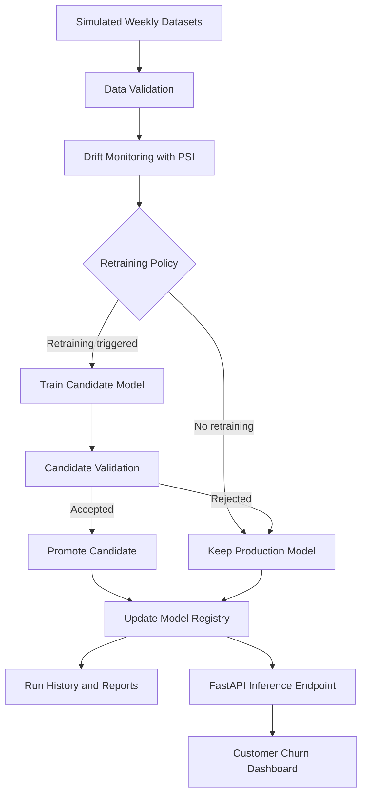

# DriftGuard: Drift-Triggered Retraining with an Orchestrated Serverless Endpoint

**A reproducible MLOps coursework project for customer churn prediction, model monitoring, and drift-triggered retraining.**

DriftGuard demonstrates how a machine learning system can monitor changing data, evaluate retraining policies, validate candidate models, and promote an approved model through a controlled workflow.

<p align="center">

[**Live Dashboard**](https://drift-triggered-retraining.onrender.com/) · [**API Documentation**](https://drift-triggered-retraining.onrender.com/docs) · [**Health Check**](https://drift-triggered-retraining.onrender.com/health) · [**GitHub Repository**](https://github.com/manjiriapshinge25/drift-triggered-retraining)

</p>

---

## Table of Contents

- [Project Overview](#project-overview)
- [Live Demo](#live-demo)
- [Problem Statement](#problem-statement)
- [Key Features](#key-features)
- [System Architecture](#system-architecture)
- [Retraining Policies and Results](#retraining-policies-and-results)
- [Model Lifecycle](#model-lifecycle)
- [Technology Stack](#technology-stack)
- [Repository Structure](#repository-structure)
- [Run Locally](#run-locally)
- [Run the Retraining Workflow](#run-the-retraining-workflow)
- [API Usage](#api-usage)
- [Testing](#testing)
- [Evidence and Reproducibility](#evidence-and-reproducibility)
- [Deployment Notes and Limitations](#deployment-notes-and-limitations)
- [Future Improvements](#future-improvements)
- [AI-Use Disclosure](#ai-use-disclosure)

## Project Overview

DriftGuard explores a practical MLOps problem: a model that performs well on historical data may become less reliable when customer behaviour and input distributions change.

The project uses eight simulated weekly datasets to investigate data drift, retraining decisions, candidate model validation, model promotion, and operational failure handling.

The system combines a reproducible local orchestration workflow with a hosted FastAPI inference endpoint.

**Project objectives:**

- Establish a reproducible baseline model and record its metrics.
- Detect changes in incoming data using Population Stability Index (PSI).
- Compare scheduled and drift-triggered retraining policies.
- Validate candidate models before promoting them to production.
- Prevent future-week data from influencing earlier retraining decisions.
- Record model versions, experiment results, and workflow events.
- Expose customer churn predictions through an HTTP API and web interface.

## Live Demo

| Component | Link |
|---|---|
| Live DriftGuard application | https://drift-triggered-retraining.onrender.com/ |
| FastAPI interactive documentation | https://drift-triggered-retraining.onrender.com/docs |
| Health endpoint | https://drift-triggered-retraining.onrender.com/health |
| GitHub source code | https://github.com/manjiriapshinge25/drift-triggered-retraining |

The hosted application provides the customer churn prediction interface. The API documentation can be used to inspect and test the available endpoints.

**Deployment note:** The Render deployment hosts the inference application. The eight-week experiment and retraining policy comparisons are reproducible project workflows; they should not be interpreted as continuous cloud retraining unless separately deployed and verified.

## Problem Statement

Machine learning models can experience **data drift** when the distribution of incoming data changes over time. Such changes may reduce prediction quality and make a previously reliable model less useful.

Retraining too frequently can waste computational resources, while retraining too rarely can allow model performance to deteriorate.

DriftGuard investigates the trade-off between prediction quality and retraining cost by comparing multiple policies on simulated weekly data.

## Key Features

- **Baseline model:** Reproducible training with a fixed random seed and recorded validation metrics.
- **Drift monitoring:** PSI-based monitoring with configurable thresholds.
- **Multiple retraining policies:** Never, weekly, low-drift-triggered, and high-drift-triggered retraining.
- **Candidate validation:** Candidate models are evaluated before production promotion.
- **Controlled model promotion:** Rejected candidates do not replace the current production model.
- **Temporal data safeguards:** Candidate training uses eligible historical data rather than future-week data.
- **Workflow history:** Model registry and run-history artifacts record experiment decisions.
- **Fault injection:** Demonstrations cover missing-column validation, candidate rejection, and transient ingestion failures.
- **REST API:** FastAPI endpoints expose health information and churn predictions.
- **Reproducible evidence:** Reports and CSV/JSON artifacts support inspection of the experiment results.

## System Architecture



The diagram describes the overall project workflow. The hosted inference endpoint and the local experiment orchestrator are separate deployment components.

## Retraining Policies and Results

The experiment compares four retraining strategies across eight simulated weeks.

| Policy | Retraining Attempts | Promotions | Mean F1 Score | Illustrative Cost |
|---|---:|---:|---:|---:|
| Never retrain | 0 | 0 | 0.383 | 0 |
| Weekly retraining | 8 | 5 | 0.401 | 90 |
| Low drift threshold (PSI ≥ 0.10) | 5 | 5 | 0.402 | 60 |
| High drift threshold (PSI ≥ 0.25) | 4 | 4 | 0.401 | 48 |

*Values are from the project's recorded policy comparison artifacts. Re-run the workflow to reproduce them.*

### Cost assumptions

The experiment uses illustrative cost units:

- 10 units per retraining attempt.
- 2 additional units per successful promotion.

These values are experimental assumptions, not actual cloud billing amounts.

### Interpretation

- The **never-retrain policy** has no retraining cost but records the lowest mean F1 score in this experiment.
- The **weekly policy** retrains most frequently and records a mean F1 score of 0.401.
- The **low-drift policy** records the highest mean F1 score in this experiment, at 0.402.
- The **high-drift policy** has the lowest non-zero illustrative cost among the tested policies, at 48 units, with a mean F1 score of 0.401.

The high-drift policy reduces illustrative cost by 20% compared with the low-drift policy, while the recorded mean F1 scores differ by only 0.001. These findings apply to the simulated experiment and do not establish that one policy is universally optimal.

## Model Lifecycle

DriftGuard follows a controlled model lifecycle:

1. Train and register a baseline model.
2. Evaluate each simulated weekly dataset.
3. Calculate drift statistics and check the selected policy.
4. Train a candidate only when the policy requires it.
5. Validate the candidate using eligible historical data.
6. Promote the candidate only if it satisfies the configured validation criteria.
7. Preserve the existing production model if the candidate is rejected.
8. Record decisions and results in the model registry and run history.

### Temporal data safeguards

The workflow is designed to prevent future-week data leakage. Candidate training uses reference data and labelled weeks strictly before the current week. Current-week labels are reserved for retrospective performance reporting rather than candidate promotion or escalation decisions.

## Technology Stack

| Technology | Purpose |
|---|---|
| Python | Core implementation and experiment orchestration |
| pandas and NumPy | Data preparation and numerical operations |
| scikit-learn | Machine learning pipeline and evaluation |
| SciPy | Statistical analysis |
| FastAPI | Inference API |
| Uvicorn | ASGI application server |
| pytest | Automated testing |
| Matplotlib and Seaborn | Experiment visualisations |
| Plotly | Interactive visualisations where used |
| Render | Hosting the inference application |
| AWS Lambda / AWS SAM scaffolding | Serverless deployment components included in the repository |

The availability of a deployment template does not imply that the corresponding AWS deployment has been performed.

## Repository Structure

The main project components include:

```text
drift-triggered-retraining/
├── app.py
├── orchestrator.py
├── src/
│   └── core.py
├── endpoint/
│   ├── app.py
│   ├── lambda_function.py
│   └── template.yaml
├── tests/
│   └── test_safety.py
├── data/
├── artifacts/
│   ├── registry.json
│   ├── run_history.json
│   └── reports/
├── requirements.txt
└── README.md
```

The exact files in your checkout may differ. Refer to the repository for the current implementation and available artifacts.

## Run Locally

### 1. Clone the repository

```bash
git clone https://github.com/manjiriapshinge25/drift-triggered-retraining.git
cd drift-triggered-retraining
```

### 2. Create a virtual environment

On Windows:

```powershell
python -m venv .venv
.venv\Scripts\Activate.ps1
```

If PowerShell blocks script activation, use Command Prompt and run:

```bat
.venv\Scripts\activate.bat
```

### 3. Install dependencies

```bash
python -m pip install --upgrade pip
pip install -r requirements.txt
```

### 4. Start the inference API

From the project root:

```bash
uvicorn app:app --host 127.0.0.1 --port 8000
```

Open the following URLs:

- Application: http://127.0.0.1:8000/
- API documentation: http://127.0.0.1:8000/docs
- Health check: http://127.0.0.1:8000/health

Use the actual entry point and instructions from the repository if the local version differs from the deployed application.

## Run the Retraining Workflow

The project provides a command-line orchestrator for running the simulated experiment.

Examples:

```bash
python orchestrator.py --reset --policy drift_high
python orchestrator.py --reset --policy never
python orchestrator.py --reset --policy weekly
python orchestrator.py --reset --policy drift_low
```

These commands demonstrate the available policies. Check `python orchestrator.py --help` for supported arguments and options before running them.

**Important:** Resetting the workflow may regenerate or overwrite experiment artifacts. Back up any results you need to preserve before using `--reset`.

The notebook-based workflow can also be used to inspect data preparation, model training, and experiment outputs where the relevant notebook and input data are present.

## API Usage

The live API documentation is available at:

https://drift-triggered-retraining.onrender.com/docs

### Health check

```bash
curl https://drift-triggered-retraining.onrender.com/health
```

### Prediction endpoint

The `/predict` endpoint accepts a JSON request containing the customer features expected by the deployed application.

Example request structure:

```json
{
  "Tenure_Months": 12,
  "Contract_Type": "Month-to-month",
  "Internet_Service": "Fiber optic",
  "Monthly_Charges": 75.0
}
```

This is an illustrative partial payload. The complete request must include all fields required by the deployed endpoint. Refer to `/docs` for the authoritative schema and accepted values.

The response contains the prediction information provided by the application, including the churn prediction and any associated probability or model-version information returned by the endpoint.

## Testing

Run the test suite from the project root:

```bash
pytest -q
```

The tests cover the safety and validation behaviour implemented in the repository. Test results should be verified against the current checkout before being reported as passing.

The project also includes fault-injection scenarios for:

- Missing input columns.
- Candidate model rejection.
- Transient ingestion failures and retry behaviour.

## Evidence and Reproducibility

Inspect the saved artifacts to understand and reproduce the experiment.

| Artifact | Purpose |
|---|---|
| `artifacts/registry.json` | Model registry and version information |
| `artifacts/run_history.json` | Recorded workflow history |
| `artifacts/reports/policy_comparison.csv` | Policy comparison metrics and costs |
| `artifacts/reports/policy_timeline.png` | Retraining policy timeline visualisation |
| `artifacts/reports/` | Additional experiment reports and evidence, where present |

The exact artifact filenames should be checked against the current repository. Reported metrics should be supported by saved outputs or reproducible execution.

## Deployment Notes and Limitations

- The live Render service hosts the inference application.
- Render's free instance may sleep after inactivity, which can introduce a cold-start delay.
- The simulated eight-week experiment is not the same as continuous live production monitoring.
- The repository includes AWS Lambda/SAM deployment scaffolding; a real AWS deployment requires the appropriate account, configuration, permissions, and verification.
- Local model-load or warm-cache timing measurements must not be presented as cloud latency benchmarks.
- PSI is a drift indicator; detected input drift does not automatically prove a reduction in prediction quality.
- The policy results depend on the simulated data, validation rules, and illustrative cost assumptions.

## Future Improvements

Potential extensions include:

- Add scheduled monitoring for a continuously updated production data stream.
- Store monitoring metrics and model versions in a persistent database.
- Add dashboards for drift, model performance, and retraining events.
- Add alerts when drift or performance thresholds are exceeded.
- Evaluate calibration, precision, recall, and business impact alongside F1.
- Deploy and benchmark the orchestration workflow in a verified serverless environment.
- Add automated CI checks for tests, code quality, and data leakage.

## AI-Use Disclosure

OpenAI ChatGPT was used as an AI-assisted development tool to help plan, scaffold, debug, explain, and document parts of this project.

The student team is responsible for reviewing the generated suggestions, understanding the implementation, verifying the experiment outputs, and accurately describing any changes made after AI assistance. This disclosure should be updated to reflect the specific code reviewed, tests executed, and modifications actually completed by the team.

AI-generated suggestions are not experimental evidence by themselves. Metrics, deployment claims, and test results should be supported by the repository artifacts or direct verification.

---

**Project:** DriftGuard — Drift-Triggered Retraining with an Orchestrated Serverless Endpoint  
**Repository:** [manjiriapshinge25/drift-triggered-retraining](https://github.com/manjiriapshinge25/drift-triggered-retraining)  
**Live demo:** [drift-triggered-retraining.onrender.com](https://drift-triggered-retraining.onrender.com/)
