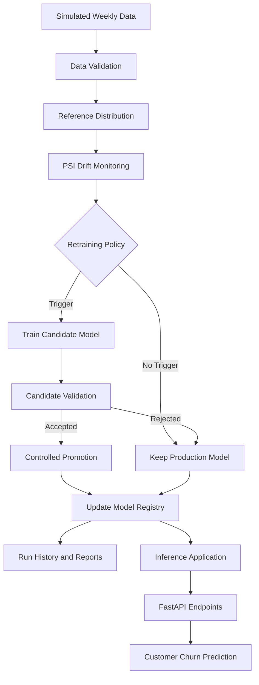

# 🚀 DriftGuard — Drift-Triggered Retraining with an Orchestrated Serverless Endpoint

**A reproducible MLOps coursework project demonstrating customer churn prediction, data drift monitoring, policy-driven model retraining, model validation, and controlled production model promotion.**

[](https://www.python.org/)
[](https://fastapi.tiangolo.com/)
[](https://render.com/)
[](https://github.com/manjiriapshinge25/drift-triggered-retraining)

**🌐 Live Demo:** [DriftGuard — MLOps Control Center](https://drift-triggered-retraining.onrender.com/)

---

## 📌 Table of Contents

1. [Project Overview](#-project-overview)
2. [Problem Statement](#-problem-statement)
3. [Objectives](#-objectives)
4. [Key Features](#-key-features)
5. [System Architecture](#-system-architecture)
6. [Project Workflow](#-project-workflow)
7. [Data and Experimental Setup](#-data-and-experimental-setup)
8. [Drift Detection](#-drift-detection)
9. [Retraining Policies](#-retraining-policies)
10. [Experimental Results](#-experimental-results)
11. [Model Registry and Promotion](#-model-registry-and-promotion)
12. [Fault Handling and Safety](#-fault-handling-and-safety)
13. [Technology Stack](#-technology-stack)
14. [Repository Structure](#-repository-structure)
15. [Installation and Setup](#-installation-and-setup)
16. [Running the API](#-running-the-api)
17. [Running the Retraining Workflow](#-running-the-retraining-workflow)
18. [Testing](#-testing)
19. [Evidence and Reproducibility](#-evidence-and-reproducibility)
20. [Deployment Architecture](#-deployment-architecture)
21. [Limitations](#-limitations)
22. [Future Improvements](#-future-improvements)
23. [AI-Use Disclosure](#-ai-use-disclosure)

---

## 📖 Project Overview

Machine learning models are often trained on historical data and deployed to make predictions on new data. Over time, however, customer behaviour, market conditions, and input data distributions may change. This phenomenon is known as **data drift**.

When drift occurs, a model that previously performed well may become less suitable for the incoming data. Retraining can help, but retraining too frequently increases computational and operational costs. Retraining too infrequently may allow model quality to deteriorate.

**DriftGuard** explores this trade-off through a reproducible MLOps workflow for customer churn prediction.

The project uses eight simulated weekly datasets to compare retraining strategies. It includes drift monitoring, candidate training, validation gates, model promotion, registry updates, workflow history, and failure-handling scenarios.

The project combines two related components:

- **Inference service:** A FastAPI application hosted on Render that exposes customer churn prediction functionality.
- **Experiment orchestration:** A reproducible workflow for comparing retraining policies and recording model lifecycle decisions.

The hosted inference API and the simulated retraining experiment are separate components. The live API does not, by itself, imply that continuous retraining is running in the cloud.

## 🎯 Problem Statement

A deployed model can gradually become less effective as the distribution of real-world inputs changes.

A practical MLOps system must decide:

- When should a model be retrained?
- How much drift is enough to trigger retraining?
- How should a newly trained candidate be validated?
- What happens if a candidate performs poorly?
- How can future data leakage be prevented?
- How can model versions and decisions be reproduced?
- How can prediction quality be balanced against retraining cost?

DriftGuard investigates these questions by evaluating multiple retraining policies on simulated weekly customer churn data.

## 🎯 Objectives

The primary objectives are:

1. Build a reproducible baseline machine learning pipeline.
2. Record baseline validation metrics and model metadata.
3. Monitor weekly datasets for distribution changes using PSI.
4. Compare scheduled and drift-triggered retraining policies.
5. Train candidate models using eligible historical data.
6. Validate candidates before changing the production model.
7. Preserve the existing production model when a candidate is rejected.
8. Record model versions, decisions, and experiment history.
9. Test failure scenarios such as invalid input data and transient ingestion errors.
10. Provide a REST API for customer churn predictions.
11. Report all tested policies, including their performance and illustrative costs.

## ✨ Key Features

### 1. Reproducible baseline model

The baseline pipeline uses a fixed random seed and records validation metrics, model metadata, and registry information.

### 2. Drift monitoring

The workflow calculates PSI to compare incoming feature distributions with a reference distribution.

### 3. Policy-driven retraining

The orchestrator supports four policies: never retrain, weekly retraining, low-drift-triggered retraining, and high-drift-triggered retraining.

### 4. Candidate model validation

A candidate is evaluated before promotion. Training a candidate does not automatically make it the production model.

### 5. Controlled model promotion

The production model is updated through the defined workflow and registry mechanism rather than by manually overwriting the active model.

### 6. Temporal data safeguards

The workflow excludes future-week information from earlier training and promotion decisions.

### 7. Experiment tracking

The project records run history, registry state, policy comparisons, and supporting reports.

### 8. Fault-injection scenarios

The workflow includes scenarios for missing-column validation, candidate rejection, and transient ingestion failure.

### 9. REST inference API

FastAPI provides endpoints for checking model health and generating customer churn predictions.

### 10. Deployment demonstration

The inference service is hosted on Render, while the experiment orchestration remains a separate workflow unless independently deployed.

---

## 🏗️ System Architecture



The architecture separates the model lifecycle experiment from the deployed prediction service. The registry and workflow artifacts provide evidence of experiment decisions, while the hosted API serves inference requests.

### Main components

| Component | Responsibility |
|---|---|
| Weekly data inputs | Represent changes in customer data over time |
| Data validation | Check required fields and input structure |
| Drift monitor | Compare feature distributions using PSI |
| Policy engine | Decide whether retraining should be attempted |
| Candidate trainer | Train a replacement model when triggered |
| Validation gate | Decide whether a candidate is eligible for promotion |
| Model registry | Track model versions and production selection |
| Run history | Record workflow outcomes |
| FastAPI service | Expose inference and health endpoints |

## 🔄 Project Workflow

The workflow follows these stages:

1. **Initialize:** Prepare the baseline model, registry, and experiment artifacts.
2. **Read weekly data:** Process each simulated week in chronological order.
3. **Validate input:** Check the input structure before continuing.
4. **Measure drift:** Calculate PSI relative to the reference distribution.
5. **Evaluate policy:** Decide whether the configured policy triggers retraining.
6. **Train candidate:** Use eligible historical data to train a candidate model.
7. **Validate candidate:** Apply the configured acceptance criteria.
8. **Promote or reject:** Promote an accepted candidate through the workflow or retain the existing production model.
9. **Record results:** Update registry information and run history.
10. **Report metrics:** Produce policy comparisons and retrospective performance summaries.

This sequence makes retraining decisions traceable and helps separate model training from production model promotion.

## 📊 Data and Experimental Setup

The project uses **eight simulated weekly datasets** to investigate model behaviour under different data conditions.

The experiment compares policies using recorded metrics such as:

- Retraining attempts.
- Successful model promotions.
- Mean F1 score.
- Illustrative retraining cost.
- Weekly drift and workflow decisions.

The weekly experiment is a controlled demonstration rather than a claim of continuous production monitoring.

### Temporal validation

For each week, candidate training uses the reference data and labelled weeks strictly before the current week.

Current-week labels are reserved for retrospective performance reporting and are not used to train or approve that week's candidate. Future-week data must not influence decisions made for earlier weeks.

This separation is important because using information from the future would make the evaluation unrealistic and could inflate reported performance.

## 📉 Drift Detection

### Population Stability Index (PSI)

Population Stability Index measures changes in a feature's distribution between a reference dataset and a comparison dataset.

A commonly used formulation is:

\[
PSI = \sum_{i=1}^{n}(A_i-E_i)\ln\left(\frac{A_i}{E_i}\right)
\]

Where:

- \(A_i\) is the proportion of observations in bin \(i\) in the comparison dataset.
- \(E_i\) is the proportion of observations in bin \(i\) in the reference dataset.
- \(n\) is the number of bins.

Small PSI values indicate that the distributions are relatively similar, while larger values indicate greater distributional change.

### Thresholds used in the experiment

| Policy | Drift trigger |
|---|---|
| Never retrain | No drift-triggered retraining |
| Weekly | Scheduled retraining |
| Low drift | PSI ≥ 0.10 |
| High drift | PSI ≥ 0.25 |

These thresholds are experiment settings, not universal rules. PSI measures distribution changes; it does not independently establish that predictive performance has declined.

---

## 🔁 Retraining Policies

Four policies are evaluated using the same general experimental framework.

### Policy 1: Never retrain

The production model remains unchanged throughout the experiment.

**Purpose:** Establish a reference point for understanding what happens when retraining costs are avoided.

**Trade-off:** The model may become less suitable as incoming data changes.

### Policy 2: Weekly retraining

The workflow attempts retraining every simulated week.

**Purpose:** Evaluate a scheduled retraining strategy.

**Trade-off:** Frequent attempts may increase costs, and not every candidate necessarily passes validation.

### Policy 3: Low-drift-triggered retraining

Retraining is triggered when PSI reaches or exceeds 0.10.

**Purpose:** Respond earlier to distributional changes.

**Trade-off:** More frequent triggers may increase operational costs.

### Policy 4: High-drift-triggered retraining

Retraining is triggered when PSI reaches or exceeds 0.25.

**Purpose:** Reduce retraining attempts by requiring a larger distributional change.

**Trade-off:** Smaller changes may not trigger retraining even when they could be operationally relevant.

## 📈 Experimental Results

The recorded policy comparison reports the following results:

| Policy | Retraining Attempts | Promotions | Mean F1 Score | Illustrative Cost |
|---|---:|---:|---:|---:|
| Never retrain | 0 | 0 | 0.383 | 0 |
| Weekly retraining | 8 | 5 | 0.401 | 90 |
| Low drift (PSI ≥ 0.10) | 5 | 5 | 0.402 | 60 |
| High drift (PSI ≥ 0.25) | 4 | 4 | 0.401 | 48 |

*Source: recorded project policy comparison artifacts. Re-run the workflow to reproduce the results.*

### Cost assumptions

The experiment uses illustrative cost units:

- **10 units** for each retraining attempt.
- **2 additional units** for each successful promotion.

These are abstract experiment costs, not actual cloud-provider billing figures.

### Interpretation of results

**Never retrain:** This policy has zero illustrative retraining cost but the lowest mean F1 score in the recorded experiment.

**Weekly retraining:** This policy makes eight attempts and records five successful promotions. Its mean F1 score is 0.401, with an illustrative cost of 90 units.

**Low-drift policy:** This policy makes five attempts and records five promotions. It achieves the highest recorded mean F1 score of 0.402, at an illustrative cost of 60 units.

**High-drift policy:** This policy makes four attempts and records four promotions. Its mean F1 score is 0.401, with the lowest non-zero illustrative cost of 48 units.

The high-drift policy reduces illustrative cost by 20% compared with the low-drift policy:

\[
\frac{60-48}{60}\times100=20\%
\]

The difference in their recorded mean F1 scores is only 0.001. For this simulated experiment, the high-drift policy therefore offers a lower-cost alternative with a very similar recorded mean F1 score.

These results should not be generalized beyond the experiment without additional datasets, repeated trials, and validation.

## 🗂️ Model Registry and Promotion

The model registry provides a record of the model versions used in the workflow.

The promotion process is designed around a controlled sequence:

1. Train a candidate model when the selected policy requires it.
2. Evaluate the candidate using the configured validation criteria.
3. Promote the candidate only when the acceptance criteria are satisfied.
4. Update the production model selection through the defined workflow.
5. Record the outcome in the registry and run history.

If validation fails, the current production model should remain active. This prevents an unapproved candidate from automatically replacing the model serving predictions.

The project includes registry artifacts and recorded model-version information to support inspection of these decisions.

## 🛡️ Fault Handling and Safety

The project includes fault scenarios intended to test the workflow's behaviour under failure conditions.

| Scenario | Expected behaviour |
|---|---|
| Missing required input column | Reject invalid input during validation |
| Candidate model rejected | Preserve the current production model |
| Transient ingestion failure | Retry according to the configured retry behaviour |

The recorded experiment also includes escalation information for selected weeks. Refer to the saved run history and fault-injection reports for the actual outcomes.

### Safety principles

- Validate input data before using it.
- Keep training data temporally separated.
- Do not promote candidates without validation.
- Preserve the existing production version when a candidate fails.
- Record decisions for later inspection.
- Do not treat a deployment template as evidence of a completed cloud deployment.

---

## 🧰 Technology Stack

| Technology | Role |
|---|---|
| Python | Main implementation language |
| pandas | Data preparation and manipulation |
| NumPy | Numerical computation |
| scikit-learn | Machine learning pipeline and evaluation |
| SciPy | Statistical utilities |
| FastAPI | REST API |
| Uvicorn | ASGI server |
| pytest | Automated tests |
| Matplotlib | Visualisation |
| Seaborn | Statistical visualisation |
| Plotly | Interactive visualisations where used |
| Render | Hosting the inference application |
| AWS Lambda / AWS SAM | Serverless deployment scaffolding included in the repository |

The availability of AWS-related files does not establish that the project has been deployed to AWS.

## 📁 Repository Structure

The main project files include the following components. Check the current repository for the exact set of files and generated artifacts.

```text
drift-triggered-retraining/
├── app.py
├── orchestrator.py
├── src/
│   └── core.py
├── endpoint/
│   ├── app.py
│   ├── lambda_function.py
│   └── template.yaml
├── tests/
│   └── test_safety.py
├── data/
├── artifacts/
│   ├── registry.json
│   ├── run_history.json
│   └── reports/
├── requirements.txt
└── README.md
```

### Important files

- `app.py` — root FastAPI application used for the hosted inference interface.
- `orchestrator.py` — command-line entry point for the retraining experiment.
- `src/core.py` — core workflow and model lifecycle logic.
- `endpoint/` — additional endpoint and serverless deployment scaffolding.
- `tests/` — automated tests.
- `artifacts/` — registry, run history, and experiment evidence.
- `requirements.txt` — Python dependencies.

## 💻 Installation and Setup

### Prerequisites

Install:

- Python 3.10 or a compatible version for the project's dependencies.
- Git.
- A terminal or Command Prompt.

### Step 1: Clone the repository

```bash
git clone https://github.com/manjiriapshinge25/drift-triggered-retraining.git
cd drift-triggered-retraining
```

### Step 2: Create a virtual environment

On Windows PowerShell:

```powershell
python -m venv .venv
.\.venv\Scripts\Activate.ps1
```

If PowerShell prevents script activation, use Command Prompt:

```bat
.venv\Scripts\activate.bat
```

### Step 3: Install dependencies

```bash
python -m pip install --upgrade pip
pip install -r requirements.txt
```

### Step 4: Verify the environment

```bash
python --version
pytest --version
```

If a command fails, check that the virtual environment is active and that dependency installation completed successfully.

## 🌐 Running the API Locally

From the project root, run:

```bash
uvicorn app:app --host 127.0.0.1 --port 8000
```

Open the local API documentation at:

```text
http://127.0.0.1:8000/docs
```

The local health endpoint is:

```text
http://127.0.0.1:8000/health
```

The root endpoint serves the application interface if configured in the current version.

### API endpoints

| Method | Endpoint | Purpose |
|---|---|---|
| GET | `/health` | Check application or model health |
| POST | `/predict` | Generate a customer churn prediction |
| GET | `/docs` | Explore and test API endpoints through Swagger UI |

The `/docs` route is provided by FastAPI's interactive documentation. The deployed application's schema is the source of truth for request fields, data types, and required values.

### Testing a prediction

1. Open the live demo or the local `/docs` page.
2. Expand the `POST /predict` endpoint.
3. Select **Try it out**.
4. Enter the JSON payload matching the endpoint's schema.
5. Execute the request.
6. Inspect the response and returned model information.

Use the exact request schema displayed by the application rather than assuming that example fields are sufficient.

## ⚙️ Running the Retraining Workflow

The project includes a command-line orchestrator with support for different policies.

Check the available options first:

```bash
python orchestrator.py --help
```

Example commands:

```bash
python orchestrator.py --reset --policy never
python orchestrator.py --reset --policy weekly
python orchestrator.py --reset --policy drift_low
python orchestrator.py --reset --policy drift_high
```

The exact supported flags and defaults are defined by the current version of `orchestrator.py`.

**Important:** The `--reset` option may regenerate or overwrite experiment state. Back up any artifacts you need to preserve before running a reset.

### Fault-injection examples

The orchestrator supports additional fault-injection options in the project implementation. Consult `python orchestrator.py --help` for the exact option names and valid values.

The intended scenarios include:

- Missing-column validation.
- Candidate rejection.
- Transient ingestion failure.

Use the recorded reports and run history to inspect the resulting workflow decisions.

## 🧪 Testing

Run the automated test suite from the project root:

```bash
python -m pytest -q
```

The test suite includes safety-related checks for the implemented workflow.

Tests should be run against the current checkout before reporting a passing status. A previous test result does not guarantee that later code changes remain correct.

### Additional verification

For a complete project review, verify:

- The API starts successfully.
- The health endpoint responds.
- The prediction endpoint accepts valid input and rejects invalid input appropriately.
- Rejected candidates do not replace the production model.
- The workflow does not use future-week data in earlier decisions.
- Each retraining policy produces the expected experiment artifacts.
- Model registry and run-history records agree with the recorded results.
- No secrets or credentials are committed to the repository.

## 📚 Evidence and Reproducibility

The repository contains artifacts intended to support the reported experiment results.

| Artifact | Purpose |
|---|---|
| `artifacts/registry.json` | Registry state and model-version information |
| `artifacts/run_history.json` | Recorded workflow history |
| `artifacts/reports/` | Policy results, visualisations, and supporting evidence where present |
| Policy comparison CSV | Comparison of retraining attempts, promotions, metrics, and costs |
| Timeline visualisation | Representation of policy decisions across the simulated weeks |
| Fault-injection reports | Evidence of selected failure-handling scenarios |

Exact filenames can vary by the current repository version. Inspect the actual files before referencing them in a submission.

### Reproducibility principles

- Keep the random seed fixed where configured.
- Preserve the experiment configuration.
- Retain the original policy comparison artifacts.
- Re-run tests after implementation changes.
- Report measured values rather than estimates.
- Clearly distinguish local experiments from cloud measurements.
- Report all tested policies rather than selecting only the best-looking result.

## ☁️ Deployment Architecture

The project separates the hosted inference service from the local experiment workflow.

### Render inference service

The root FastAPI application is hosted on Render and exposes the inference interface and API endpoints.

The free service may spin down after inactivity. This can result in a delay when the service receives a request after being idle.

### Serverless scaffolding

The repository includes AWS Lambda/SAM-related deployment files. These provide scaffolding for a possible serverless deployment, but an actual AWS deployment requires appropriate configuration, permissions, deployment steps, and verification.

### What is and is not demonstrated

| Capability | Project status |
|---|---|
| Hosted FastAPI inference service | Deployed on Render |
| Interactive API documentation | Available through the hosted FastAPI application |
| Simulated weekly retraining experiment | Included in the project workflow |
| Retraining policy comparison | Supported by recorded experiment artifacts |
| Continuous cloud retraining | Not established by the Render inference deployment alone |
| Verified AWS Lambda deployment | Requires separate deployment evidence |
| Cloud cold-start/warm-start benchmarks | Must be measured on the actual cloud deployment |

## ⚠️ Limitations

1. **Simulated data:** The eight-week experiment does not establish performance on a continuously changing real-world production dataset.
2. **Illustrative costs:** Retraining costs are abstract units, not actual cloud billing.
3. **PSI limitations:** Distribution drift does not necessarily mean prediction quality has declined.
4. **Limited experiment scope:** Results depend on the selected datasets, model, thresholds, and validation criteria.
5. **Separate inference and orchestration:** Hosting the inference API does not automatically schedule retraining.
6. **Cloud deployment scope:** AWS deployment scaffolding is not equivalent to a deployed and tested AWS workflow.
7. **Generalisation:** The recorded policy results should not be assumed to apply to other datasets or production systems without additional experiments.

## 🚀 Future Improvements

Possible extensions include:

- Integrate continuous data ingestion and scheduled monitoring.
- Add persistent storage for model versions and monitoring events.
- Create dashboards for PSI, prediction quality, and retraining history.
- Add alerts for drift, degraded performance, and failed training runs.
- Evaluate precision, recall, ROC-AUC, calibration, and business impact alongside F1.
- Test multiple random seeds and additional datasets.
- Deploy the orchestration workflow to a verified cloud environment.
- Measure cloud latency, cold starts, and warm requests independently.
- Add CI/CD automation for tests, code quality, and model validation.
- Add model explainability and feature-level drift reports.
- Document each team member's actual contributions and technical responsibilities.

## 🤖 AI-Use Disclosure

OpenAI ChatGPT was used as an AI-assisted development tool to help plan the project, scaffold and debug parts of the implementation, explain MLOps concepts, and improve documentation.

The student team is responsible for reviewing the implementation, understanding the code, validating experiment results, running the tests, and accurately documenting changes made after AI assistance.

The final disclosure should reflect the work actually performed by the team. AI-generated suggestions are not treated as experimental evidence unless supported by reproducible outputs or direct verification.

## 👥 Team Contributions

Add the names of the project members and their actual contributions here before submission.

For example:

- **Member 1:** Document the components personally implemented, tested, and reviewed.
- **Member 2:** Document the components personally implemented, tested, and reviewed.

Replace these examples with the team's real contributions. Every member should be able to explain the data flow, retraining policies, validation gate, registry, experiment results, and deployment limitations.

---

## 📌 Final Summary

DriftGuard demonstrates a controlled approach to model retraining under data drift. By comparing four policies, validating candidate models, preserving the production model when validation fails, and recording experiment decisions, the project highlights the importance of reproducibility and safeguards in MLOps.

The recorded experiment shows that the high-drift policy achieves a lower illustrative cost than the low-drift policy while maintaining a very similar mean F1 score. These results apply to the project's simulated setting and require further validation before being generalized to production systems.

**Live Demo:** [DriftGuard — MLOps Control Center](https://drift-triggered-retraining.onrender.com/docs)

**Repository:** [manjiriapshinge25/drift-triggered-retraining](https://github.com/manjiriapshinge25/drift-triggered-retraining)
